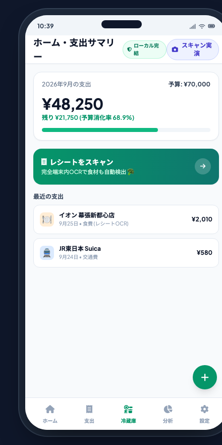
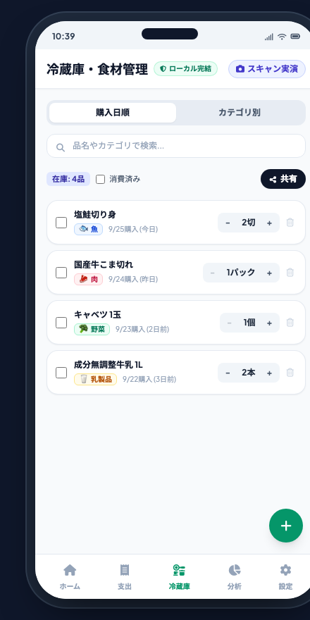
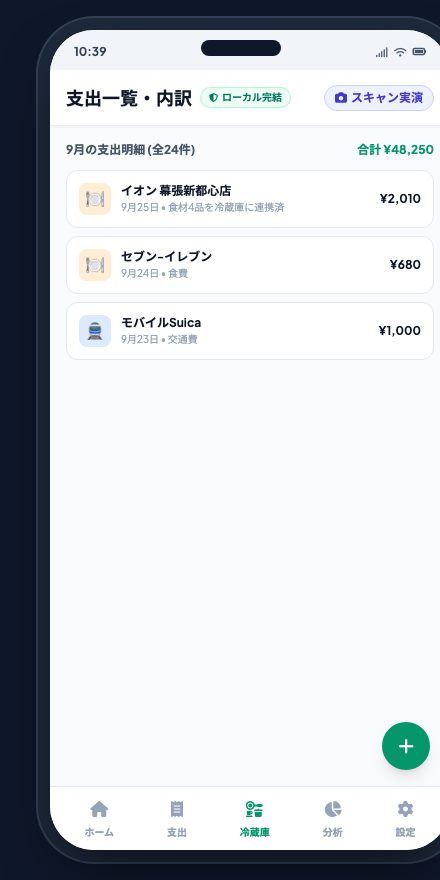
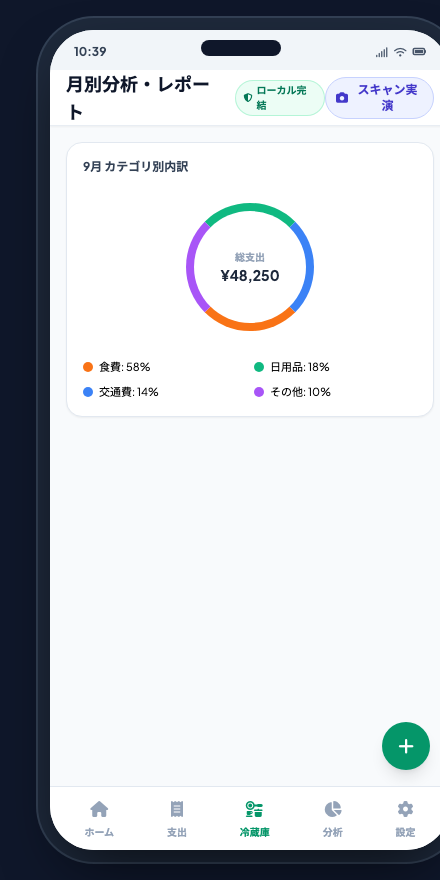
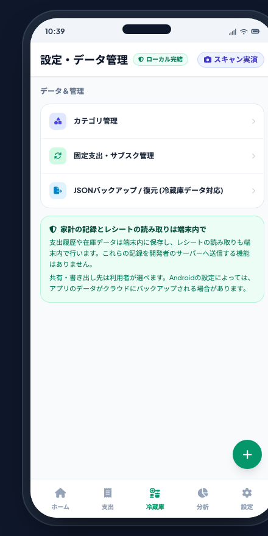

# local-budget 📱

**端末内で家計の記録とレシートの読み取りができる、プライバシー重視の Android 支出・食材管理アプリ。**

  

---

## 📸 アプリ画面ギャラリー (Play Store Style)

| 1. ホーム・支出サマリー | 2. 冷蔵庫・食材管理 | 3. 支出一覧・詳細内訳 |
|:---:|:---:|:---:|
|  |  |  |
| 予算消化率・円グラフ・月別推移グラフ | レシートから食材自動抽出・消費管理 | 日別小計・レシート品目内訳表示 |

| 4. 月別分析・支出レポート | 5. 設定・データ管理 |
|:---:|:---:|
|  |  |
| カテゴリ別構成比・サブスク候補一覧 | JSON/CSVバックアップ・端末内完結の安心設計 |

---

## 🌟 主な機能と特徴

### 1. 🔒 端末内でのデータ保存とレシート読み取り
* 支出履歴や在庫データは端末内のデータベース (Room SQLite) に保存され、レシートの文字認識（OCR）も端末同梱のオンデバイス ML Kit モデルで動作します。
* 読み取ったデータや家計情報を**開発者の外部サーバーへ送信する機能はありません**。
* 共有やバックアップは、ユーザー自身が選んで標準の共有シートやファイル保存で行えます。

### 2. 🧾 高速・高精度なオンデバイス レシートOCR
* カメラをかざすだけでレシートを検出し、ブレを抑えて自動シャッター・連続読み取り。
* 店舗名・日付・税込合計金額（外税含む）に加え、**購入品目（品名・数量・単価・値引き）**まで高精度に抽出。
* ギャラリー内の写真や画像からの読み取りにも対応。

### 3. 🥬 冷蔵庫・冷凍庫・常温パントリーの食材管理
* レシートから野菜・肉・魚・乳製品などの食材を自動判別して在庫に追加。
* ワンタップで「使い切り」管理。賞味期限の目安表示。
* **家族共有機能**: Android標準の共有シート経由で、LINEやメモ帳へワンタップで在庫リストを送信可能。

### 4. 📊 直感的な予算管理と分析
* Jetpack Compose Canvas による高速・軽量な円グラフ（ドーナツチャート）と月別バーチャート。
* 食費の週別内訳や、定期サブスクリプションの自動検知候補リスト。

---

## 📥 インストール方法 (APK)

1. お手持ちの Android 端末（Android 8.0 Oreo 以上）で、[最新の Releases](https://github.com/YoIV-dev/local-budget-app/releases/latest) から `app-debug.apk` をダウンロードします。
2. ダウンロードした APK をタップして開きます。
3. 初回インストール時、「提供元不明のアプリのインストール」の許可を求められた場合は、画面の指示に従ってブラウザまたはファイルマネージャーに許可を与えてください。
4. インストール完了後、アプリをご利用いただけます。

---

## 🏗 技術スタック

* **OS**: Android 8.0+ (Min SDK 26, Target SDK 35)
* **言語**: Kotlin
* **UI**: Jetpack Compose + Material 3
* **アーキテクチャ**: Clean Architecture + MVVM
* **ローカルDB**: Room SQLite (Room v3)
* **機械学習/OCR**: Google ML Kit Text Recognition (日本語 Bundled モデル - 完全オフライン)
* **カメラ**: CameraX (Live Scanning, Auto Capture)

---

## 📄 ライセンス

本プロジェクトは [MIT License](LICENSE) のもとで公開されています。
