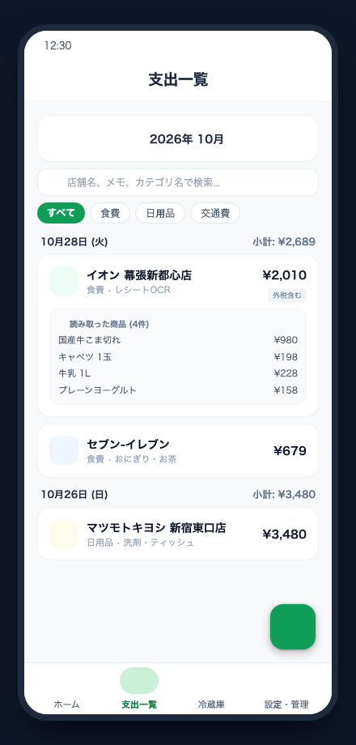
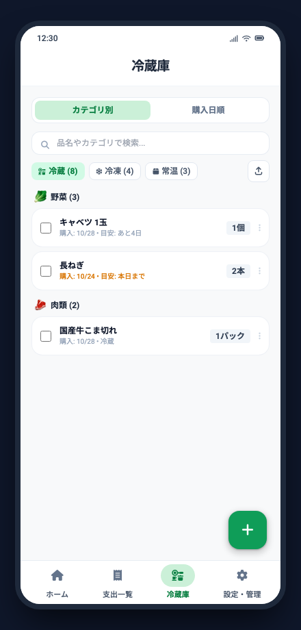
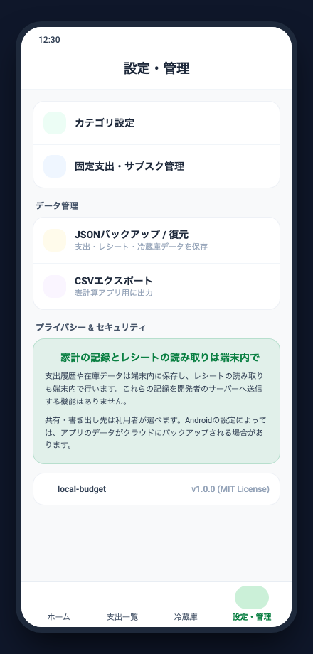

# local-budget

本アプリは、日々の支出と冷蔵庫の食材をまとめて管理できるAndroidアプリです。

  

---

## アプリ画面

| 1. ホーム (支出サマリー・推移) | 2. 支出一覧 (日別小計・レシート内訳) |
|:---:|:---:|
|  |  |
| 予算進捗・円グラフ・週別食費・サブスク候補 | 日別小計・レシート読み取り品目・カテゴリ検索 |

| 3. 冷蔵庫 (食材管理・消費) | 4. 設定・管理 (データ保存・プライバシー) |
|:---:|:---:|
|  |  |
| レシートから自動登録・賞味期限・家族共有 | JSON/CSVバックアップ・端末内完結の安心設計 |

---

## 3つの特徴と既存アプリとの違い

- レシートから食材まで自動登録  
  カメラでレシートを撮影するだけで、合計金額だけでなく購入した食材まで自動で在庫に反映します。何を買ったかを手入力する手間がかかりません。

- 使い切りをアプリから定期確認  
  消費期限が近づいた食材や、購入から日数が経った食材について、使い切ったかどうかを通知で確認します。アプリを開き直して在庫を点検しなくても、食材の使い忘れを防げます。

- 外部送信のない完全ローカル動作  
  会員登録や外部サーバーへのデータ通信を行いません。レシートの文字認識から家計データの保管まで、すべて端末内だけで完結するため、購買履歴が外部に送信される心配がありません。

---

## 本アプリでできること

レシートをカメラで撮影するだけで、合計金額だけでなく、購入した品目まで自動で読み取ります。読み取った食材はそのまま在庫として登録され、賞味期限の目安確認や使い切りの記録ができます。LINEなどのアプリを使って、現在の在庫リストを家族に共有することも可能です。また、月ごとの予算消化状況や食費の週別内訳、継続して支払っているサブスクリプションの候補も自動で整理します。

---

## インストール方法

本アプリはパスワードで保護されたアーカイブ形式で配布しています。作者からパスワードを受け取った方のみご利用いただけます。

1. Android端末（Android 8.0以上）で、[最新のReleases](https://github.com/YoIV-dev/local-budget-app/releases/latest)から `local-budget-protected.zip` をダウンロードします。
2. ファイルマネージャー等でZIPファイルを開き、配布されたパスワードを入力して解凍します。
3. 解凍された `app-debug.apk` をタップして開きます。
4. 初回インストール時に「提供元不明のアプリのインストール」の許可を求められた場合は、画面の指示に従って許可してください。
5. インストール完了後、すぐにご利用いただけます。

---

## ライセンス

Copyright (c) 2026 YoIV-dev. All rights reserved.  
本ソフトウェアは私的配布専用です。権利者の許可なく複製、改変、再配布することを禁じます。詳細は [LICENSE](LICENSE) をご確認ください。
